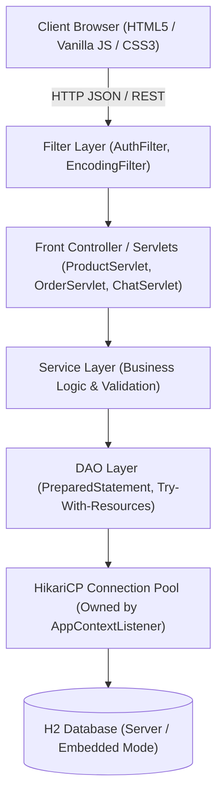
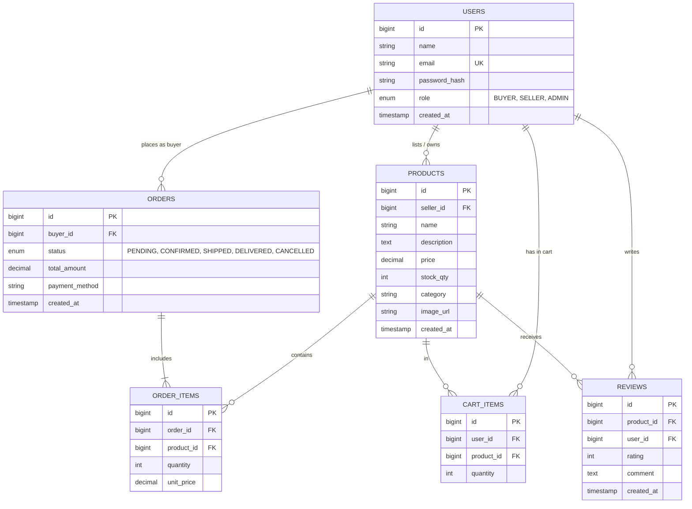
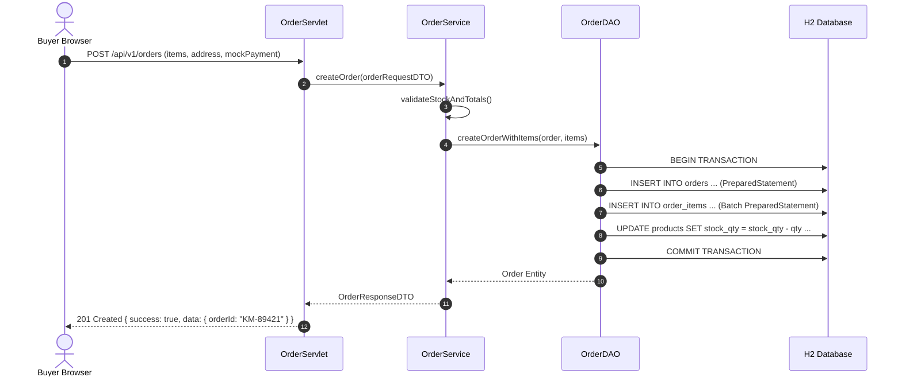

# 🛒 KarthiMart — Multi-Seller E-Commerce Marketplace

> **Anna University R2025, Semester 3 — Web Technology Project**  
> **Builder:** Karthi Prabhu | **Coursework Window:** Jul 27 – Oct 10, 2026

---

## 📌 Problem Statement

Traditional single-vendor e-commerce portals restrict independent merchants from listing their own goods while burdening buyers with fragmented shopping experiences. **KarthiMart** resolves this by delivering a **unified, multi-seller marketplace** where independent sellers create, price, and fulfill their product catalogs, while buyers seamlessly search, filter, cart, and mock-checkout goods under a single cart transaction. Platform superadmins oversee users, orders, and listing moderation with full workflow governance.

---

## 📐 System Architecture

KarthiMart adheres to a strict **Layered MVC Pattern** over Servlets (Front Controller Pattern):

---

## 📊 Database ER Diagram (D1)

---

## 🔄 Place Order Sequence Diagram (D3)

---

## 🛠️ Technology Stack

| Component | Specification |
| :--- | :--- |
| **Frontend** | HTML5, CSS3 (Custom Design Tokens, Responsive Grid), Vanilla ES6+ |
| **Client Storage** | LocalStorage state engine with reactive event bus |
| **Java Platform** | OpenJDK 17 (LTS) |
| **Servlet Container** | Apache Tomcat 9.0.x (`javax.servlet.*`) |
| **Build Tool** | Apache Maven 3.9+ |
| **Database** | H2 Database (`server` mode for prod, `mem` for automated tests) |
| **Connection Pool** | HikariCP 5.1.0 (Managed via `AppContextListener`) |
| **Security** | jBCrypt 0.4 (Salt factor 10, no plaintext passwords) |
| **JSON Serialization**| Google Gson 2.10.1 |
| **Testing** | JUnit 5 + Mockito 5.11 |
| **Logging** | SLF4J + Logback |
| **CI/CD** | GitHub Actions (`.github/workflows/build.yml`) |

---

## 🔑 Demo Sandbox Accounts (1-Click Test)

Pre-seeded accounts are provided for instant evaluation:

| Role | Name | Email | Password | Key Permissions |
| :--- | :--- | :--- | :--- | :--- |
| **Buyer** | Priya Sharma | `buyer@karthimart.com` | `password123` | Browse catalog, add to cart, checkout, view tracking, write reviews |
| **Seller**| Apex Electronics | `seller@karthimart.com` | `password123` | Add/edit/delete listings, track inventory stock, view incoming orders |
| **Admin** | Karthi Admin | `admin@karthimart.com` | `password123` | Platform oversight, order status workflow control, listing moderation |

---

## 📋 Feature Compliance Checklist

- [x] **F1: User Registration & Login**: Multi-role support (`BUYER`, `SELLER`), seed account for `ADMIN`.
- [x] **F2: Seller Listing Management**: Create, edit, delete listings with images, descriptions, price, and stock.
- [x] **F3: Product Catalog & Search**: Real-time keyword search, category filter chips, price range slider, stock toggles.
- [x] **F4: Cart & Stepper**: Quantity stepper, stock limit enforcement, promotional coupon codes (`KARTHI10`, `WELCOME20`).
- [x] **F5: Mock Checkout**: Shipping address validation, mock payment gateway (UPI, Cards, Net Banking, COD).
- [x] **F6: Order History & Tracking**: 4-stage tracking stepper (`PENDING` → `CONFIRMED` → `SHIPPED` → `DELIVERED`).
- [x] **F7: Admin Governance**: Platform GMV analytics, order status updates, catalog moderation, user directory.
- [x] **F8: Product Reviews**: Verified customer star ratings (1–5) and feedback on delivered orders.
- [x] **O1: Wishlist**: Save items for later with persistent heart toggles.
- [x] **O2: Status Workflow**: Full state machine with cancellation protection.
- [x] **O3: Seller Analytics**: Revenue calculation, units fulfilled, active catalog valuation.
- [x] **O4: AI Shopping Assistant**: Floating widget with natural language product search, order lookup, and guardrails.

---

## 🌐 Public Link Deployment

To deploy this project online and get an instant live public URL:

1. Visit **[Netlify Drop](https://app.netlify.com/drop)**.
2. Drag and drop this project directory.
3. Your live link is immediately generated!

For GitHub Pages or Vercel setup, see [DEPLOYMENT.md](file:///c:/Users/ishva/OneDrive/Karthi%20prabhu%20Mart/DEPLOYMENT.md).
